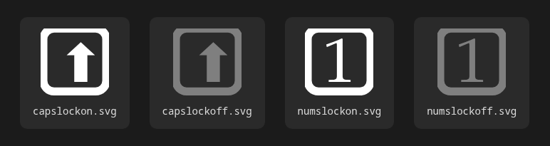

# lock-keys

A Rust workspace for showing Caps Lock and Num Lock state on the COSMIC desktop (Pop!_OS): a small daemon that watches the keyboard through evdev, and two COSMIC panel applets, one per key.

This is an early, unfinished project. The daemon detects Caps Lock and Num Lock key events and prints them. The applets build, but they don’t talk to the daemon yet, so each one always shows its “on” icon.



*The applets’ icons from `capslock/resources/` and `numslock/resources/`, rendered in a browser. This is not a screenshot of the panel: these demos were made on a Hyprland machine without COSMIC, so the applets couldn’t be shown running.*

## What works today

- **Daemon** (`daemon/`): scans `/dev/input/event*`, opens the first device that reports a Caps Lock or Num Lock key, then loops over its events and prints every `KEY_CAPSLOCK` and `KEY_NUMLOCK` event.
- **Applets** (`capslock/`, `numslock/`): built on [libcosmic](https://github.com/pop-os/libcosmic)’s applet template. Each puts an icon button in the panel that opens a popup. The popup still holds the template’s “Example Row” toggle.
- **systemd unit** (`daemon/lock-keys.service`): runs the daemon as root, since reading `/dev/input` needs root or membership of the `input` group.

## How it works

- `daemon/src/main.rs` uses the [`evdev`](https://crates.io/crates/evdev) crate. A device counts as a keyboard if `supported_keys()` contains `KEY_CAPSLOCK` or `KEY_NUMLOCK`. Devices it can’t open are skipped.
- `capslock/src/app.rs` and `numslock/src/app.rs` are the same code apart from the app ID and icon path. The view draws `icon_button_from_handle` with an SVG loaded by absolute path, and `update` handles opening and closing the popup.
- The `log`, `env_logger` and `signal-hook` crates are already dependencies of the daemon for the planned move to a proper background service, but aren’t used yet.

## Tech stack

Rust (workspace with resolver 3), `evdev` 0.13, libcosmic (from git) with the `applet`, `wayland`, `tokio` and `dbus-config` features, Fluent (`i18n-embed`) for strings, `just` recipes from the COSMIC applet template.

## Build and run

Needs Rust (built here with cargo 1.98.1) and the system libraries libcosmic needs (on Pop!_OS these come with the COSMIC development packages).

```bash
cargo build -p lock-keys-daemon
cargo build -p capslock -p numslock
```

Both commands built cleanly. The daemon build gives one warning (unused `log` imports), and the first applet build fetches and compiles libcosmic, which took about 80 seconds here.

The daemon must be able to read `/dev/input`. Run it as a normal user who isn’t in the `input` group and it can’t open any device, so it stops straight away. This is real output from that case:

```text
$ ./target/debug/lock-keys-daemon

thread 'main' (35089) panicked at daemon/src/main.rs:34:23:
No keyboard device found
note: run with `RUST_BACKTRACE=1` environment variable to display a backtrace
```

To see key events, run it with access to the input devices (for example `sudo ./target/debug/lock-keys-daemon`) and press Caps Lock or Num Lock. It prints `Keyboard found at: /dev/input/eventN` and then one line per press and release.

To try an applet on COSMIC, build it and add it to the panel (the `just install` recipe in `capslock/justfile` installs the binary, `.desktop` file and metainfo). Note the known issues below first.

## Known issues

- `capslock/src/app.rs` line 95 and `numslock/src/app.rs` line 95 load the icon from `/home/pro0grammer/Codes/lock-keys/...`, so on any other machine the icon won’t be found.
- `daemon/lock-keys.service` line 7 runs `/home/pro0grammer/Codes/lock-keys/target/debug/daemon`, but the binary is called `lock-keys-daemon`, and the path is specific to one machine.
- Both applets use the binary name `lock-keys` in their `justfile` and `.desktop` file, while Cargo builds them as `capslock` and `numslock`. `just install` also expects `resources/icon.svg`, which doesn’t exist.
- The daemon only watches the first matching device, so a second keyboard (or a virtual one listed earlier) is missed.

## Project structure

```text
Cargo.toml              workspace: daemon, capslock, numslock
daemon/
  src/main.rs           evdev keyboard scan and event loop
  lock-keys.service     systemd unit (runs as root)
capslock/               COSMIC applet for Caps Lock
  src/app.rs            applet model, view and popup
  resources/            capslockon.svg, capslockoff.svg, .desktop, metainfo
  i18n/en/              Fluent strings
  justfile              build and install recipes
numslock/               the same applet for Num Lock
docs/icons.png          the icons shown above
```
